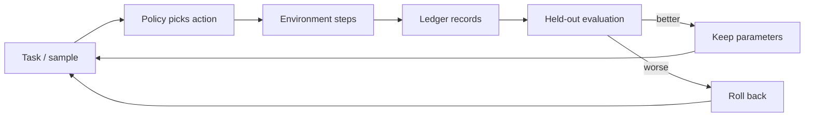

# The whole thing on one page

> This page is enough. No code reading required.
> [中文](ONE-PAGE.md) | **English**

---

## What it is

```
┌─────────────────────────────────────────────────────────┐
│  An 8×8 room                                            │
│                                                         │
│    . . . . . . . .       F = food        (+1 when eaten) │
│    . F . . # . . .       # = wall        (blocks movement)│
│    . . # . . . F .       H = hazard zone (two hits = dead)│
│    . . . H . . . .                                      │
│    . . . . . F . .       a policy walks 60 steps in it   │
└─────────────────────────────────────────────────────────┘
                          ↓
      it learns (Q-learning), then is scored on **unseen maps**
                          ↓
      every step goes into a **hash-chained ledger** (edit one byte and verification fails)
```

**One sentence:** a program that runs experiments on itself and keeps an auditable record of every step.
Not a chatbot, not an LLM, no GPU, no network.

---

## The loop



---

## Three commands

```bash
git clone https://github.com/xiaoyu123-xiao/open-functional-self-lab.git
cd open-functional-self-lab
python -m lab.cli doctor                        # expect "all checks passed"
python -m lab.cli loop --cycles 3 --lethal      # learn for three cycles
```

The third command prints four lines: **score before → score after → kept or rolled back → how it compares
to a hand-written rule**.

---

## Evidence (two numbers, one command)

| Task | Hand-written rule | Learned policy |
|---|---|---|
| lethal hazards = 8 | −1.758 | **+1.597** |
| lethal hazards = 10 | −2.340 | **+0.573** |

Reproduce: `python -m lab.cli transfer --algo weighted --repeats 5`

> The hand-written rule only knows the shortest path — **it cannot feel pain**. The policy is shaped by
> `hurt = −1`, `death = −5`. Valid only for one 8×8 map family with varying hazard density. **Do not extrapolate.**

---

## Boundaries: commitments vs defaults

| Kind | Content | Changeable |
|---|---|---|
| **Commitment** (about claims) | no consciousness claims; every number must be reproducible | ❌ |
| **Default** (about the demo) | one 8×8 world, CPU-only, offline | ✅ swap via `lab generic` |
| **Extension points** | environment / policy / evaluation / tasks | ✅ without touching core code |

In short: **what it claims is fixed; what it can do depends on what you plug in.**

## What a user can actually do with it

| Use | For whom |
|---|---|
| Wrap an existing loop with audit + budget + rollback | anyone scripting automation |
| Held-out evaluation harness for your own model | people training models |
| Experiment records with pre-registered criteria | researchers / students |
| Agent permission flow (`ask → grant → revoke`) | teams letting agents act |

How to plug in: [EXTEND.en.md](EXTEND.en.md) — **20 lines, two methods (`reset`/`step`, `act`)**.

---

## Next thing to read

| You are… | Read |
|---|---|
| just curious | this page |
| ready to run it | [USER-GUIDE.md](USER-GUIDE.md) (Chinese) |
| an AI agent executing this repo | [AGENT-RUNBOOK.en.md](../AGENT-RUNBOOK.en.md) |
| plugging in your own model | [DEPLOY-WITH-MODEL.md](DEPLOY-WITH-MODEL.md) (Chinese) |
| on a big machine | [HARDWARE.md](HARDWARE.md) (Chinese) |
| auditing my claims | [self-audit.md](self-audit.md) + [experiments/](experiments/) |
