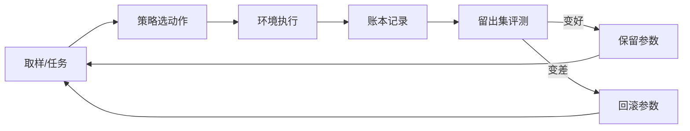

# 一页看懂

> 这一页就够。看不懂代码也能看完。

---

## 它是什么

```
┌─────────────────────────────────────────────────────────┐
│  一个 8×8 的小房间                                        │
│                                                         │
│    . . . . . . . .       F = 食物（吃到 +1）             │
│    . F . . # . . .       # = 墙（撞了不动）              │
│    . . # . . . F .       H = 危险区（碰两次就死）        │
│    . . . H . . . .                                      │
│    . . . . . F . .       一个策略在里面走 60 步           │
└─────────────────────────────────────────────────────────┘
                          ↓
        它会自己学（Q-learning），然后**换一批没见过的地图**考试
                          ↓
        考完把分数写进**账本**（改一个字节就能发现被改过）
```

**一句话**：它是个会自己做实验、并且把每次实验都记账的小程序。
不是聊天机器人，不是大模型，不需要显卡，不需要联网。

---

## 它的循环长这样



---

## 三分钟跑起来

```bash
git clone https://github.com/xiaoyu123-xiao/open-functional-self-lab.git
cd open-functional-self-lab
python -m lab.cli doctor                        # 看到"全部通过"即可
python -m lab.cli loop --cycles 3 --lethal      # 学三轮，看它变强没有
```

第三行会打印四句话，分别是：**没学时多差 → 学完多好 → 有没有保留 → 跟人类写的规则比如何**。

---

## 证据（两个数字，一条命令可复算）

| 任务 | 手写规则（最短路径） | 学出来的策略 |
|---|---|---|
| 危险区致命，8 个 | −1.758 | **+1.597** |
| 危险区致命，10 个 | −2.340 | **+0.573** |

复算：`python -m lab.cli transfer --algo weighted --repeats 5`

> 原因很具体：手写规则只会走最短路径，**它不知道疼**；策略是从"受伤 −1、死亡 −5"学出来的。
> 只在同一张 8×8 地图、只变危险区数量时成立，**不要外推**。

---

## 它不是什么

| ❌ 不是 | 因为 |
|---|---|
| 不是有意识的 AI | 不宣称，也没有"想""怕"这类内部变量 |
| 不是通用智能 | 只在 8×8 网格里工作，换任务要重来 |
| 不是大模型 | 不下载权重、不训练语言模型 |
| 不是自动爬虫 | 默认离线；联网必须人工授权 |

---

## 你可能需要的下一份

| 你的身份 | 读这份 |
|---|---|
| 想先弄懂它 | 本页 |
| 想跑起来 | [`docs/USER-GUIDE.md`](USER-GUIDE.md) |
| 是另一个 AI，要执行 | [`AGENT-RUNBOOK.md`](../AGENT-RUNBOOK.md) |
| 想接大模型 | [`docs/DEPLOY-WITH-MODEL.md`](DEPLOY-WITH-MODEL.md) |
| 机器很强，想并行 | [`docs/HARDWARE.md`](HARDWARE.md) |
| 想知道它哪里可能错 | [`docs/self-audit.md`](self-audit.md) + [`docs/experiments/`](experiments/) |
