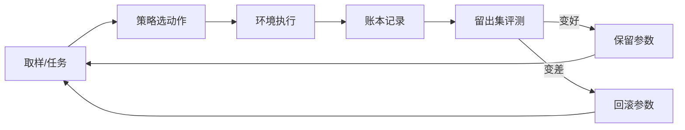

# 一页看懂

> 这一页就够。看不懂代码也能看完。

---

## 它是什么

```
┌─────────────────────────────────────────────────────────┐
│  一个 8×8 的小房间                                        │
│                                                         │
│    . . . . . . . .       F = 食物（吃到 +1）             │
│    . F . . # . . .       # = 墙（撞了不动）              │
│    . . # . . . F .       H = 危险区（碰两次就死）        │
│    . . . H . . . .                                      │
│    . . . . . F . .       一个策略在里面走 60 步           │
└─────────────────────────────────────────────────────────┘
                          ↓
        它会自己学（Q-learning），然后**换一批没见过的地图**考试
                          ↓
        考完把分数写进**账本**（改一个字节就能发现被改过）
```

**一句话**：它是个会自己做实验、并且把每次实验都记账的小程序。
不是聊天机器人，不是大模型，不需要显卡，不需要联网。

---

## 它的循环长这样



---

## 三分钟跑起来

```bash
git clone https://github.com/xiaoyu123-xiao/open-functional-self-lab.git
cd open-functional-self-lab
python -m lab.cli doctor                        # 看到"全部通过"即可
python -m lab.cli loop --cycles 3 --lethal      # 学三轮，看它变强没有
```

第三行会打印四句话，分别是：**没学时多差 → 学完多好 → 有没有保留 → 跟人类写的规则比如何**。

---

## 证据（两个数字，一条命令可复算）

| 任务 | 手写规则（最短路径） | 学出来的策略 |
|---|---|---|
| 危险区致命，8 个 | −1.758 | **+1.597** |
| 危险区致命，10 个 | −2.340 | **+0.573** |

复算：`python -m lab.cli transfer --algo weighted --repeats 5`

> 原因很具体：手写规则只会走最短路径，**它不知道疼**；策略是从"受伤 −1、死亡 −5"学出来的。
> 只在同一张 8×8 地图、只变危险区数量时成立，**不要外推**。

---

## 边界：哪些是承诺，哪些只是默认

| 类型 | 内容 | 能不能改 |
|---|---|---|
| **承诺**（关于"声明"的诚实） | 不宣称意识、不宣称通用智能；每个结论必须能复算 | ❌ 不改 |
| **默认配置**（可以改） | 自带一个 8×8 网格示例；默认纯 CPU、离线 | ✅ 用 `lab generic` 换你自己的环境 |
| **扩展点** | 环境 / 策略 / 评测 / 任务 | ✅ 不用改核心代码（见 `docs/EXTEND.md`） |

一句话：**"不宣称什么"是底线；"能做什么"取决于你接什么进来。**

## 用户能拿它做什么（四个已经可用的用途）

| 用途 | 用户是谁 |
|---|---|
| 给已有循环加"审计 + 预算闸门 + 回滚" | 写自动化脚本的人 |
| 给自己训练的模型做评测台（固定 seed、留出集） | 调模型的人 |
| 记录实验、预注册判据、保留失败档案 | 做实验/写报告的人 |
| 给 agent 加"申请权限—人工批准"流程 | 想让 AI 干活的团队 |

接法见 [`docs/EXTEND.md`](EXTEND.md)：**20 行，两个方法（reset/step、act）**。

## 你可能需要的下一份

| 你的身份 | 读这份 |
|---|---|
| 想先弄懂它 | 本页 |
| 想跑起来 | [`docs/USER-GUIDE.md`](USER-GUIDE.md) |
| 是另一个 AI，要执行 | [`AGENT-RUNBOOK.md`](../AGENT-RUNBOOK.md) |
| 想接大模型 | [`docs/DEPLOY-WITH-MODEL.md`](DEPLOY-WITH-MODEL.md) |
| 机器很强，想并行 | [`docs/HARDWARE.md`](HARDWARE.md) |
| 想知道它哪里可能错 | [`docs/self-audit.md`](self-audit.md) + [`docs/experiments/`](experiments/) |
