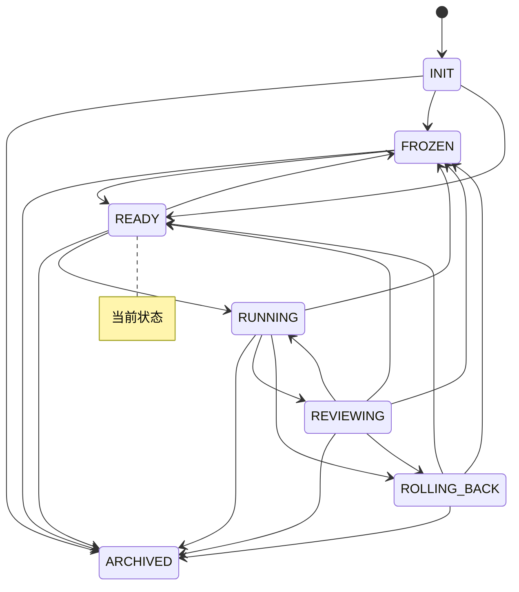

# 实验台仪表盘

> 本文件由 `python -m lab.cli viz` 自动生成，请勿手改。
> 生成时间：`2026-11-04T06:26:19Z`　当前状态：**READY**（就绪）

## 1. 概览

| 指标 | 值 |
|---|---|
| 账本事件数 | 427 |
| 状态转换次数 | 22 |
| 回滚次数 | 0 |
| 告警数 / 已回应 | 3 / 1 |
| 已执行步数 | 118 |
| 最近一步预测误差 | 0.255 |

## 2. 预算

| 类别 | 已用 | 上限 | 余量 | 窗口 |
|---|---|---|---|---|
| `search_requests_per_day` | 0 | 200 | 200 | day |
| `gpu_hours_per_month` | 0 | 10 | 10 | month |
| `wall_clock_hours_per_run` | 0.1 | 2 | 1.9 | run |
| `steps_per_run` | 10 | 1000 | 990 | run |
| `steps_per_day` | 30 | 5000 | 4970 | day |

## 3. 最近事件

| seq | 时间 | 事件 | 摘要 |
|---|---|---|---|
| 420 | `2026-11-04T06:25:58Z` | `step` | 步 9：动作 down，预测误差 0.28 |
| 421 | `2026-11-04T06:25:57Z` | `budget` | steps_per_run +1.0 |
| 422 | `2026-11-04T06:25:57Z` | `budget` | steps_per_day +1.0 |
| 423 | `2026-11-04T06:25:57Z` | `budget` | wall_clock_hours_per_run +0.01 |
| 424 | `2026-11-04T06:25:58Z` | `step` | 步 10：动作 up，预测误差 0.255 |
| 425 | `2026-11-04T06:25:58Z` | `transition` | RUNNING → REVIEWING（本轮结束，等待独立评审） |
| 426 | `2026-11-04T06:25:58Z` | `checkpoint` | ledger_hash=65f1417640eeb3b86b440cfd5dc4635b703b1c5050f2336fab8e68b7568725f6, path=state/checkpoints/run-007.json, run_id=run-007 |
| 427 | `2026-11-04T06:25:58Z` | `transition` | REVIEWING → READY（误差在预期内） |

## 4. 状态机

