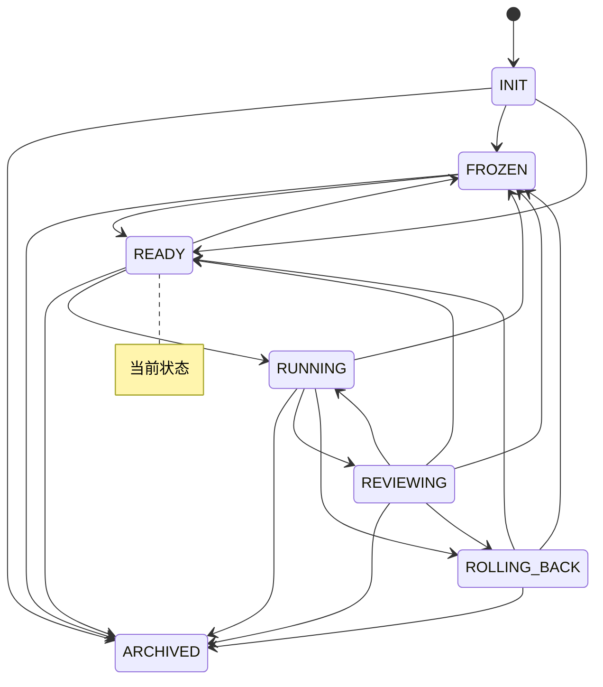

# 实验台仪表盘

> 本文件由 `python -m lab.cli viz` 自动生成，请勿手改。
> 生成时间：`2026-11-04T06:05:21Z`　当前状态：**READY**（就绪）

## 1. 概览

| 指标 | 值 |
|---|---|
| 账本事件数 | 196 |
| 状态转换次数 | 13 |
| 回滚次数 | 0 |
| 告警数 / 已回应 | 0 / 0 |
| 已执行步数 | 58 |
| 最近一步预测误差 | 0.25 |

## 2. 预算

| 类别 | 已用 | 上限 | 余量 | 窗口 |
|---|---|---|---|---|
| `search_requests_per_day` | 0 | 200 | 200 | day |
| `gpu_hours_per_month` | 0 | 10 | 10 | month |
| `wall_clock_hours_per_run` | 0 | 2 | 2 | run |
| `steps_per_run` | 0 | 1000 | 1000 | run |

## 3. 最近事件

| seq | 时间 | 事件 | 摘要 |
|---|---|---|---|
| 189 | `2026-11-04T06:04:38Z` | `budget` | wall_clock_hours_per_run +0.01 |
| 190 | `2026-11-04T06:04:39Z` | `step` | 步 19：动作 right，预测误差 0.27 |
| 191 | `2026-11-04T06:04:38Z` | `budget` | steps_per_run +1.0 |
| 192 | `2026-11-04T06:04:38Z` | `budget` | wall_clock_hours_per_run +0.01 |
| 193 | `2026-11-04T06:04:39Z` | `step` | 步 20：动作 down，预测误差 0.25 |
| 194 | `2026-11-04T06:04:39Z` | `transition` | RUNNING → REVIEWING（本轮结束） |
| 195 | `2026-11-04T06:04:39Z` | `transition` | REVIEWING → READY（独立评审通过（占位规则）） |
| 196 | `2026-11-04T06:04:39Z` | `checkpoint` | ledger_hash=21536b14c8f654c53f18896e82199538a295482bea4bdf76d2a7f1a27351bd3a, path=state/checkpoints/run-004.json, run_id=run-004 |

## 4. 状态机

