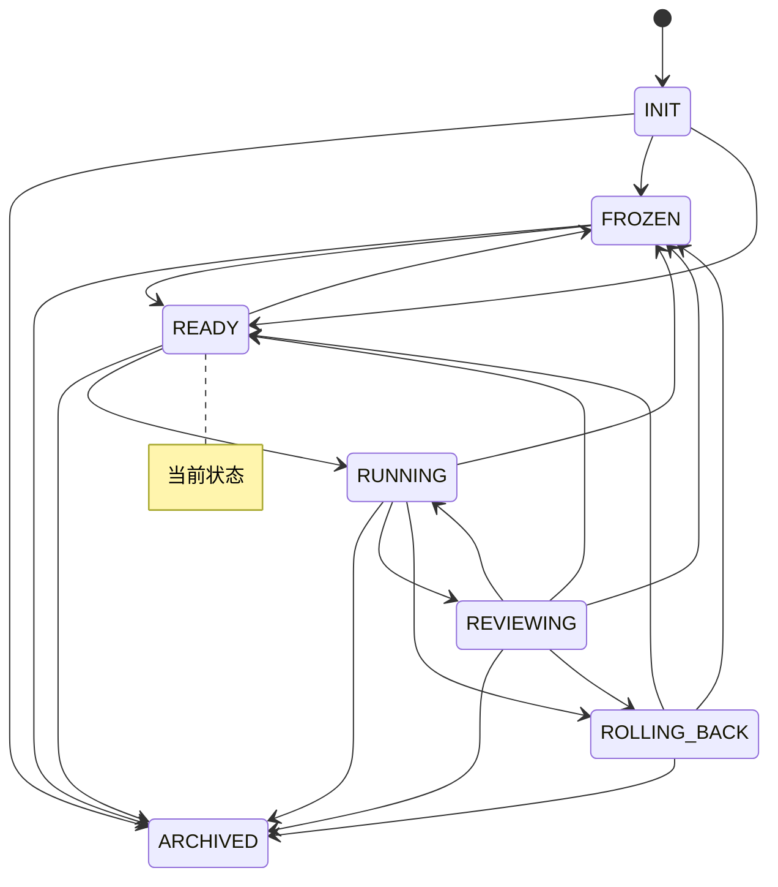

# 实验台仪表盘

> 本文件由 `python -m lab.cli viz` 自动生成，请勿手改。
> 生成时间：`2026-11-04T08:48:23Z`　当前状态：**READY**（就绪）

## 1. 概览

| 指标 | 值 |
|---|---|
| 账本事件数 | 482 |
| 状态转换次数 | 22 |
| 回滚次数 | 0 |
| 告警数 / 已回应 | 3 / 1 |
| 已执行步数 | 118 |
| 最近一步预测误差 | 0.255 |

## 2. 预算

| 类别 | 已用 | 上限 | 余量 | 窗口 |
|---|---|---|---|---|
| `search_requests_per_day` | 4 | 200 | 196 | day |
| `gpu_hours_per_month` | 0 | 10 | 10 | month |
| `wall_clock_hours_per_run` | 0 | 2 | 2 | run |
| `steps_per_run` | 9 | 1000 | 991 | run |
| `steps_per_day` | 30 | 5000 | 4970 | day |

## 3. 最近事件

| seq | 时间 | 事件 | 摘要 |
|---|---|---|---|
| 475 | `2026-11-04T08:32:44Z` | `gstep` | action=right, done=False, reward=0.0 |
| 476 | `2026-11-04T08:32:44Z` | `budget` | steps_per_run +1.0 |
| 477 | `2026-11-04T08:32:44Z` | `gstep` | action=right, done=False, reward=0.0 |
| 478 | `2026-11-04T08:32:44Z` | `budget` | steps_per_run +1.0 |
| 479 | `2026-11-04T08:32:44Z` | `gstep` | action=right, done=False, reward=0.0 |
| 480 | `2026-11-04T08:32:44Z` | `budget` | steps_per_run +1.0 |
| 481 | `2026-11-04T08:32:44Z` | `gstep` | action=right, done=True, reward=1.0 |
| 482 | `2026-11-04T08:47:51Z` | `transfer` | multi_mean=0.9623, ratio=1.2729, single_mean=0.4131 |

## 4. 状态机

