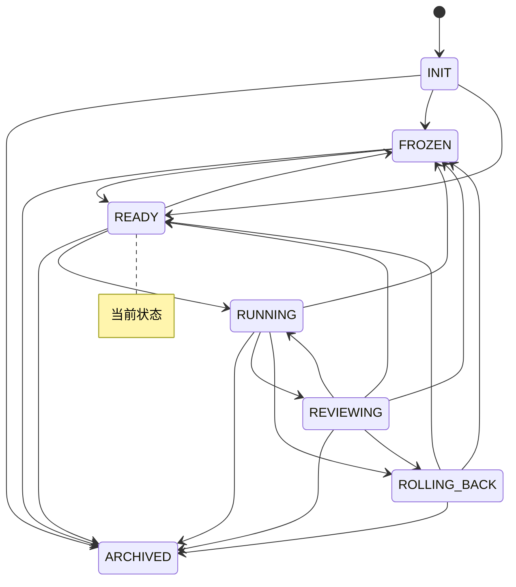

# 实验台仪表盘

> 本文件由 `python -m lab.cli viz` 自动生成，请勿手改。
> 生成时间：`2026-11-04T06:43:16Z`　当前状态：**READY**（就绪）

## 1. 概览

| 指标 | 值 |
|---|---|
| 账本事件数 | 447 |
| 状态转换次数 | 22 |
| 回滚次数 | 0 |
| 告警数 / 已回应 | 3 / 1 |
| 已执行步数 | 118 |
| 最近一步预测误差 | 0.255 |

## 2. 预算

| 类别 | 已用 | 上限 | 余量 | 窗口 |
|---|---|---|---|---|
| `search_requests_per_day` | 3 | 200 | 197 | day |
| `gpu_hours_per_month` | 0 | 10 | 10 | month |
| `wall_clock_hours_per_run` | 0.1 | 2 | 1.9 | run |
| `steps_per_run` | 10 | 1000 | 990 | run |
| `steps_per_day` | 30 | 5000 | 4970 | day |

## 3. 最近事件

| seq | 时间 | 事件 | 摘要 |
|---|---|---|---|
| 440 | `2026-11-04T06:42:21Z` | `cycle` | after=-0.12, baseline=3.565, before=1.29 |
| 441 | `2026-11-04T06:42:21Z` | `cycle` | after=-0.12, baseline=3.565, before=1.29 |
| 442 | `2026-11-04T06:42:22Z` | `cycle` | after=-0.12, baseline=3.565, before=1.29 |
| 443 | `2026-11-04T06:42:30Z` | `cycle` | after=2.2, baseline=3.565, before=-4.495 |
| 444 | `2026-11-04T06:42:30Z` | `cycle` | after=2.17, baseline=3.565, before=2.2 |
| 445 | `2026-11-04T06:42:30Z` | `cycle` | after=2.17, baseline=3.565, before=2.2 |
| 446 | `2026-11-04T06:42:31Z` | `cycle` | after=2.17, baseline=3.565, before=2.2 |
| 447 | `2026-11-04T06:42:31Z` | `cycle` | after=2.17, baseline=3.565, before=2.2 |

## 4. 状态机

