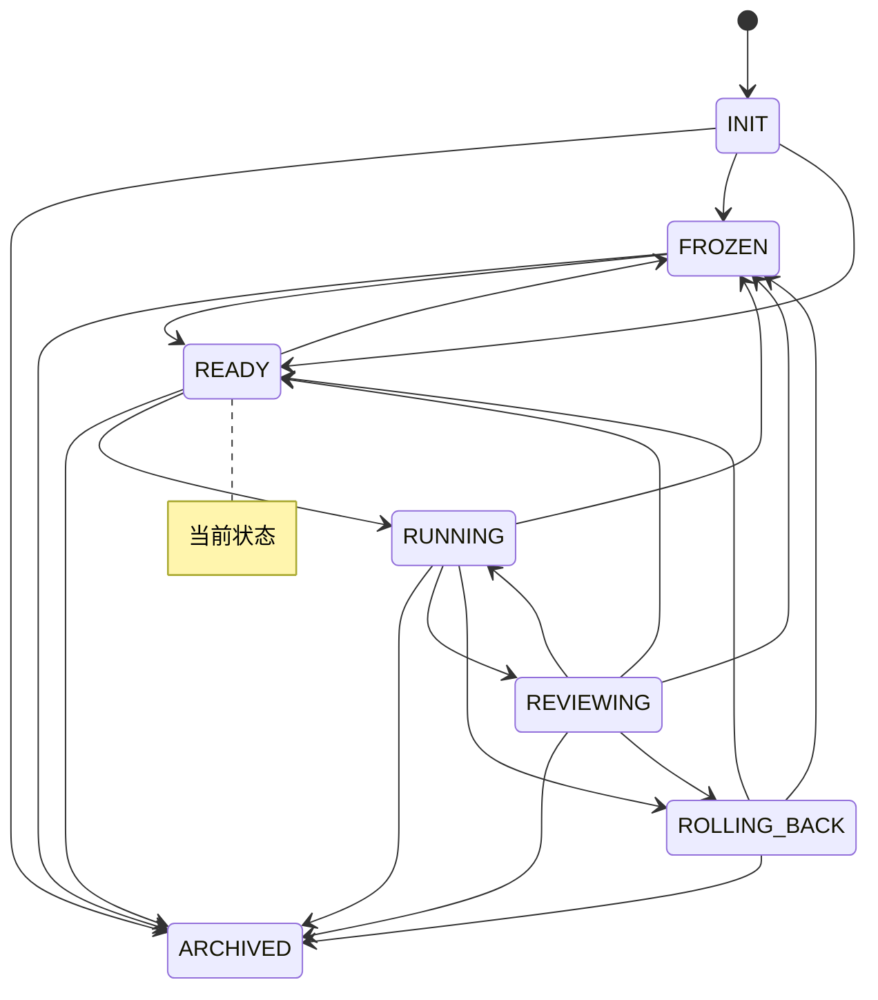

# 实验台仪表盘

> 本文件由 `python -m lab.cli viz` 自动生成，请勿手改。
> 生成时间：`2026-11-04T06:19:46Z`　当前状态：**READY**（就绪）

## 1. 概览

| 指标 | 值 |
|---|---|
| 账本事件数 | 382 |
| 状态转换次数 | 19 |
| 回滚次数 | 0 |
| 告警数 / 已回应 | 3 / 1 |
| 已执行步数 | 108 |
| 最近一步预测误差 | 0.25 |

## 2. 预算

| 类别 | 已用 | 上限 | 余量 | 窗口 |
|---|---|---|---|---|
| `search_requests_per_day` | 0 | 200 | 200 | day |
| `gpu_hours_per_month` | 0 | 10 | 10 | month |
| `wall_clock_hours_per_run` | 0.2 | 2 | 1.8 | run |
| `steps_per_run` | 20 | 1000 | 980 | run |
| `steps_per_day` | 20 | 5000 | 4980 | day |

## 3. 最近事件

| seq | 时间 | 事件 | 摘要 |
|---|---|---|---|
| 375 | `2026-11-04T06:19:37Z` | `step` | 步 19：动作 right，预测误差 0.27 |
| 376 | `2026-11-04T06:19:36Z` | `budget` | steps_per_run +1.0 |
| 377 | `2026-11-04T06:19:36Z` | `budget` | steps_per_day +1.0 |
| 378 | `2026-11-04T06:19:36Z` | `budget` | wall_clock_hours_per_run +0.01 |
| 379 | `2026-11-04T06:19:37Z` | `step` | 步 20：动作 down，预测误差 0.25 |
| 380 | `2026-11-04T06:19:37Z` | `transition` | RUNNING → REVIEWING（本轮结束，等待独立评审） |
| 381 | `2026-11-04T06:19:37Z` | `checkpoint` | ledger_hash=8f7f8663b329b75e693024c439445a4d5ab06551ebbdee0f748f427361a84d41, path=state/checkpoints/run-006.json, run_id=run-006 |
| 382 | `2026-11-04T06:19:38Z` | `transition` | REVIEWING → READY（指标在预期范围内） |

## 4. 状态机

