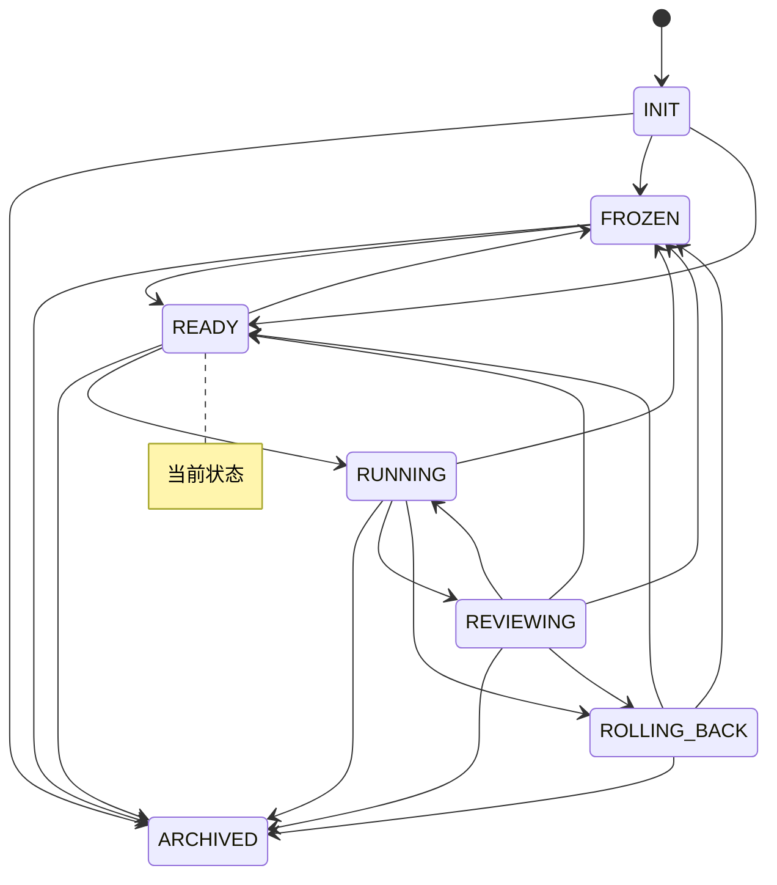

# 实验台仪表盘

> 本文件由 `python -m lab.cli viz` 自动生成，请勿手改。
> 生成时间：`2026-11-04T07:32:46Z`　当前状态：**READY**（就绪）

## 1. 概览

| 指标 | 值 |
|---|---|
| 账本事件数 | 457 |
| 状态转换次数 | 22 |
| 回滚次数 | 0 |
| 告警数 / 已回应 | 3 / 1 |
| 已执行步数 | 118 |
| 最近一步预测误差 | 0.255 |

## 2. 预算

| 类别 | 已用 | 上限 | 余量 | 窗口 |
|---|---|---|---|---|
| `search_requests_per_day` | 4 | 200 | 196 | day |
| `gpu_hours_per_month` | 0 | 10 | 10 | month |
| `wall_clock_hours_per_run` | 0.1 | 2 | 1.9 | run |
| `steps_per_run` | 10 | 1000 | 990 | run |
| `steps_per_day` | 30 | 5000 | 4970 | day |

## 3. 最近事件

| seq | 时间 | 事件 | 摘要 |
|---|---|---|---|
| 450 | `2026-11-04T07:04:18Z` | `learn` | added=0, errors=0, fetched=1 |
| 451 | `2026-11-04T07:07:55Z` | `perm_request` | asked_at=2026-11-04T07:07:55Z, id=req-46967a, reason=需要从 arXiv 取新声明以补交叉验证 |
| 452 | `2026-11-04T07:19:00Z` | `autonomy` | by=xiaoyu123-xiao, capabilities=['web.fetch', 'gpu.train', 'storage.write', 'repo.private-read'], days=90 |
| 453 | `2026-11-04T07:19:00Z` | `cycle` | after=2.4, algo=tabular, armor=False |
| 454 | `2026-11-04T07:19:00Z` | `cycle` | after=2.2487, algo=tabular, armor=False |
| 455 | `2026-11-04T07:23:19Z` | `cycle` | after=0.8333, algo=tabular, armor=False |
| 456 | `2026-11-04T07:23:24Z` | `cycle` | after=0.8333, algo=tabular, armor=False |
| 457 | `2026-11-04T07:32:20Z` | `transfer` | multi_mean=0.1046, ratio=0.1418, single_mean=0.7375 |

## 4. 状态机

